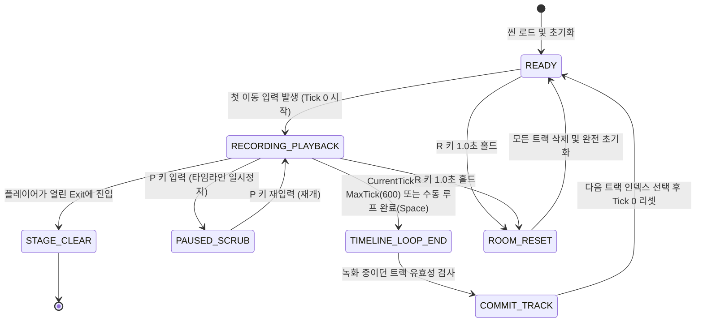

# 잔상 배선공 (Afterimage Electrician) - 프로토타입 기술 및 게임 디자인 명세서

- **문서 버전**: v1.0.0
- **대상 엔진**: Godot 4.2+ / 4.3 (Standard GDScript)
- **작성 대상**: 1인~소규모 인디 개발팀 (기획자·프로그래머·테스터)
- **핵심 목표**: 1개의 튜토리얼 방에서 **입력 기록**, **최대 3개 잔상 재생**, **다중 압력판 동시 활성화**, **출구 진입**의 코어 루프 재미와 고정 틱 결정론을 4주 내에 완벽히 검증한다.
- **범위 제약**: 외부 에셋 0개 (Godot 기본 `ColorRect`, `Line2D`, `Polygon2D`, 기본 폰트만 사용), 플러그인 0개, 온라인 네트워킹 없음.

---

## 1. 핵심 재미 가설 및 튜토리얼 방(Tutorial Room) 레벨 디자인

### 1.1 핵심 재미 가설 (Core Fun Hypothesis)
> *"과거의 나와 현재의 내가 오차 0.5초 이내로 정밀하게 호흡을 맞춰 거대한 기계 장치를 가동하고 닫히는 문을 통과할 때, 마치 4인 협동 하이스트(Heist)를 혼자서 지휘해 성공시킨 것 같은 성취감을 준다."*

1. **시간 릴레이 체감**: 혼자서는 절대 닿을 수 없는 거리의 세 스위치를 잔상들의 정밀한 타이밍으로 묶어내는 조작감.
2. **원인 규명 가능한 실패**: 실패했을 때 "내가 왜 늦었는지", "몇 초에 잔상이 발을 뗐는지"를 즉각 눈으로 보고 1초 만에 부분 재녹화로 교정하는 쾌감.

---

### 1.2 튜토리얼 방 구조 (`Room 0: 주 배전실 동기화`)

화면 해상도 1280x720 (16:9), 타일 크기 40x40 픽셀 기준 (32x18 그리드).

```text
+-------------------------------------------------------------------------------+
| [TIMELINE UI: 0.0s ======================= [TICK: 0/600] ==================== 10.0s] |
| [TRACKS:  T1(Amber): REC/PLAY  |  T2(Green): EMPTY  |  T3(Purple): EMPTY  | LIVE(Cyan)]  |
+-------------------------------------------------------------------------------+
| ############################################################################# |
| # [SPAWN]                                                                   # |
| #  (플레이어)          [회로선 L1]                    +---[출구 격벽(DOOR)]---+ # |
| #      v         +---------------------+              |  삼중 AND 래치 연동   | # |
| #      v         |                     v              +-----------+---------+ # |
| #   [판 A]       |                  [판 B]                        |         # |
| #  (ALPHA)       |                  (BETA)                        v         # |
| #  (x:4, y:6)    |                 (x:14, y:6)                 [EXIT]       # |
| #                |                                           (x:28, y:3)    # |
| #                |                                                      # |
| #                +-----[회로선 L2]-----+                                    # |
| #                                      |                                    # |
| #                                      v                                    # |
| #                                   [판 C]                                  # |
| #                                  (GAMMA)                                  # |
| #                                 (x:14, y:12)                              # |
| ############################################################################# |
```

#### 객체 구성 및 배치 좌표 (그리드 40px 단위)
1. **스폰 지점 (Spawn)**: `(x: 2, y: 3)` - 모든 사이클 시작 시 플레이어와 재생 잔상들이 생성되는 지점.
2. **압력판 A (Plate Alpha)**: `(x: 4, y: 6)` - 스폰에서 약 1.5초 거리.
3. **압력판 B (Plate Beta)**: `(x: 14, y: 6)` - 스폰에서 약 3.5초 거리.
4. **압력판 C (Plate Gamma)**: `(x: 14, y: 12)` - 스폰에서 약 5.0초 거리.
5. **출구 격벽 (Security Gate)**: `(x: 26, y: 3)` - 닫혀 있는 보안문 (StaticBody2D).
6. **탈출 지점 (Exit Trigger)**: `(x: 28, y: 3)` - 문 통과 시 스테이지 클리어.
7. **배선 (Wires)**: 판 A, B, C에서 출발하여 출구 격벽 제어 박스로 이어지는 바닥 발광 라인 (`Line2D`).

#### 방 해결 표준 시퀀스 (총 루프 시간 10.0초 = 600 Physics Ticks)
- **트랙 1 (잔상 1 - Amber)**:
  - 0.0s 스폰 → 1.5s 판 A 도착 → **1.5s ~ 10.0s 동안 판 A 위에 지속 대기**.
- **트랙 2 (잔상 2 - Mint Green)**:
  - 0.0s 스폰 → 3.5s 판 B 도착 → **3.5s ~ 10.0s 동안 판 B 위에 지속 대기**.
- **트랙 3 (잔상 3 - Neon Purple)**:
  - 0.0s 스폰 → 5.0s 판 C 도착 → **5.0s ~ 10.0s 동안 판 C 위에 지속 대기**.
- **라이브 플레이어 (Live Player - Cyan)**:
  - 트랙 1, 2, 3이 확정된 4번째 사이클 실행:
  - 0.0s ~ 5.0s 동안 출구 격벽 앞(`x: 24, y: 3`)으로 미리 이동하여 대기.
  - **5.0s 시점**: 판 A(잔상1), 판 B(잔상2), 판 C(잔상3)가 **동시에 밟힘** → 삼중 AND 논리 완성 → 배선 발광 및 출구 격벽 개방!
  - 5.2s ~ 6.0s: 열린 격벽을 통과해 `[EXIT]` 영역으로 진입 → **스테이지 클리어!**

---

## 2. 상태 전이 모델 (State Transition Architecture)

### 2.1 룸 라이프사이클 상태 머신 (`RoomState`)



| 상태명 | 진입 조건 | 동작 내용 | 탈출 조건 |
|---|---|---|---|
| `READY` | 씬 시작 또는 루프 리셋 직후 | 틱 카운터 = 0. 플레이어 및 잔상 대기. 입력 대기 중. | 방향키 입력 감지 시 `RECORDING_PLAYBACK` 전이 |
| `RECORDING_PLAYBACK` | 틱 0 가동 시작 | 매 고정 틱마다 활성 트랙 입력 버퍼 기록, 기저장 트랙 동시 재생, 기믹 시뮬레이션 | 600틱 도달, Space(완료), 클리어, P(스크럽) |
| `PAUSED_SCRUB` | P 키(Pause) 토글 | 물리 시뮬레이션 일시 정지. 좌/우 화살표로 틱 수동 스크럽 | P 키 재토글 시 해당 틱에서 시뮬레이션 재개 |
| `COMMIT_TRACK` | 루프 종료 시 | 현재 녹화 트랙을 읽기 전용 잔상 데이터로 변환. 다음 빈 트랙 자동 지정 | 트랙 리셋 완료 후 `READY`로 복귀 |
| `STAGE_CLEAR` | 출구 Area2D 진입 | 조작 잠금, 성공 연출(초록 플래시), 결과 틱 및 시간 표시 | 재시도 또는 다음 스테이지 |
| `ROOM_RESET` | R 키 홀드(1초) | 3개 트랙 전체 폐기, 틱 0으로 리셋, 초기 스폰 복구 | 즉시 `READY` 전이 |

---

### 2.2 트랙 슬롯 상태 머신 (`TrackState`: 0~2번 잔상 슬롯)

각 잔상 트랙은 독립적인 상태를 가집니다:
- `EMPTY (0)`: 녹화된 데이터가 없음.
- `RECORDING (1)`: 현재 루프에서 플레이어의 물리 입력 프레임을 기록 중.
- `COMMITTED (2)`: 녹화 완료. 매 루프마다 틱에 맞춰 자동 재생되는 불변(Immutable) 상태.
- `SELECTED_FOR_RERECORD (3)`: 사용자가 부분 재녹화를 위해 지정한 상태. 루프 시작 시 기존 데이터를 덮어씀.

---

### 2.3 기믹 엔티티 상태 머신

#### A. 압력판 (`PressurePlate`)
- **`RELEASED` (비활성)**:
  - 판 위에 접촉한 엔티티 수 `occupant_count == 0`.
  - 출력 신호 `power = false`. 스프라이트 기본 높이/색상.
- **`PRESSED` (활성)**:
  - 접촉한 엔티티(플레이어 또는 유효 잔상) `occupant_count > 0`.
  - 출력 신호 `power = true`. 스프라이트 압축 연출, 해당 잔상의 전용 색상으로 테두리 발광.

#### B. 보안 격벽 (`ExitGate`)
- **`LOCKED`**:
  - 조건: `(PlateA.power AND PlateB.power AND PlateC.power) == false`
  - 물리 충돌체 활성화 (`CollisionShape2D.disabled = false`), 적색 차단선 표시.
- **`UNLOCKED`**:
  - 조건: `(PlateA.power AND PlateB.power AND PlateC.power) == true`
  - 물리 충돌체 비활성화 (`disabled = true`), 녹색 개방 연출, 통과 가능.

---

## 3. 조작 체계 및 입력 버퍼 사양 (Controls & Input Specs)

### 3.1 입력 매핑 테이블

| 기능 | 키보드 키 | 게임패드 버튼 | 비고 |
|---|---|---|---|
| 상/하/좌/우 이동 | W, S, A, D / 방향키 | D-Pad / 좌측 아날로그 스틱 | 8방향 허용 (상하좌우 4방향 우선 퀀타이즈) |
| 조기 녹화 완료/루프 넘김 | `Space` / `Enter` | `A` / `Cross` | 10초를 다 채우지 않고 즉시 트랙 확정 |
| 트랙 1 선택 / 재녹화 지정 | `1` | `LB` + `X` | 트랙 1을 재녹화 대상으로 전환 |
| 트랙 2 선택 / 재녹화 지정 | `2` | `LB` + `Y` | 트랙 2를 재녹화 대상으로 전환 |
| 트랙 3 선택 / 재녹화 지정 | `3` | `LB` + `B` | 트랙 3을 재녹화 대상으로 전환 |
| 선택 트랙 삭제 | `Delete` / `Backspace` | `RB` + `X` | 선택 트랙 데이터만 비우고 `EMPTY`화 |
| 타임라인 정지 / 스크럽 모드 | `P` / `Tab` | `Select` / `View` | 틱 단위 앞/뒤 탐색 진입 |
| 스크럽 이동 (정지 시) | `[` / `]` 또는 마우스 휠 | `LT` / `RT` | 틱 -10 / +10 스크럽, 방향키로 ±1틱 정밀 스크럽 |
| 룸 전체 초기화 | `R` (1초간 길게 누름) | `Y` (1초간 길게 누름) | 게이지 충전 UI 표시 후 전면 리셋 |

---

### 3.2 입력 패킷 구조 및 ±1틱 입력 버퍼 (Input Buffering)

#### 1프레임 입력 데이터 구조 (`InputFrame`)
```gdscript
class_name InputFrame
var tick: int = 0
var move_x: int = 0      # -1, 0, 1 (정수)
var move_y: int = 0      # -1, 0, 1 (정수)
var interact: bool = false # 상호작용/액션 플래그
```

#### ±1틱 입력 스무딩 및 버퍼링 정책
- 플레이어의 인간 반응 속도는 60Hz 틱(약 16.6ms) 단위에서 1틱 오차로 입력이 누락될 수 있음.
- **선입력 버퍼 (+1 Tick)**:
  - 틱 경계 직전(약 10ms 이내)에 발생한 방향 전환이나 정지 입력은 다음 틱(`Tick + 1`)의 시작 입력으로 즉시 등록.
- **후입력 보정 (-1 Tick)**:
  - 압력판을 밟는 타이밍이 1틱 늦었을 때, 잔상과 플레이어 간의 AND 게이트 판정 시 **"판정 완화 윈도우(Tolerance Window) = ±2 틱 (약 33ms)"**을 허용.
  - 즉, 판 A, B, C가 1~2틱 차이로 엇갈려 밟히더라도 회로가 즉시 꺼지지 않고 2틱간 잔류 신호(Hold-over)를 유지하여 플레이어의 불합리한 실패감을 원천 차단.

---

## 4. 실패 및 재시도 UX (Failure & Retry UX)

시간 복제 퍼즐의 가장 큰 실패 요인은 **"내가 왜 실패했는지 알 수 없는 모호함"**과 **"처음부터 다시 녹화해야 하는 피로감"**입니다. 이를 해결하기 위한 구체적 장치입니다.

### 4.1 실패 원인 가각화 (Failure Explainability)

1. **타임라인 동기화 게이지 (Sync Timeline Overlay)**:
   - 상단 타임라인 바 하단에 각 트랙별 "스위치 점유 구간"을 색상 밴드로 표시.
   ```text
   [TIMELINE: 0s --------- 3s -------- 5s -------- 8s -------- 10s]
   T1 (Amber) :             [======== Plate A 점유 ========]
   T2 (Green) :                     [=== Plate B 점유 ===]
   T3 (Purple):                            [=== Plate C 점유 ===]
   ----------------------------------------------------------------
   AND 판정   :                            [SYNC!] -> 이때만 문 열림
   실패 지점  :                                  ^ T2가 여기서 먼저 발을 뗌! (경고 점멸)
   ```
2. **이탈 경고 고스트 하이라이트 (Desync Marker)**:
   - 잔상이 압력판에서 발을 떼는 순간, 바닥에 붉은색 잔류 마커(`X`)와 함께 "T2 LEFT EARLY (-0.4s)" 텍스트가 0.8초간 프로시저럴 플로팅.

---

### 4.2 쾌속 재시도 루프 (Frictionless Iteration)

1. **트랙 개별 재녹화 (Single-Track Re-recording)**:
   - 3개 트랙 중 2번 트랙만 타이밍이 어긋났다면, 키 `2`를 누르면 트랙 1과 3은 그대로 유지된 채 트랙 2만 즉시 재녹화 모드로 전환.
   - 씬 전체 리로드 없이 `Tick = 0`으로 즉각 타임슬립. (대기 시간 0.0초)
2. **섀도 고스트 (Ghost-of-Ghost) 가이드**:
   - 재녹화 중일 때, 이전에 실패했던 기존 트랙의 궤적이 30% 투명도의 붉은 잔상으로 앞서 달림. 플레이어는 "아, 아까는 여기서 너무 빨리 나갔구나"를 보며 템포를 맞출 수 있음.
3. **무벌칙 즉각 취소**:
   - 재녹화 도중 실수를 인지했을 때 `R`을 가볍게 한 번 누르면 해당 루프의 0초로 즉시 되감김.

---

## 5. 색상 팔레트 및 시각 피드백 (Color & Visual Feedback)

외부 이미지 파일 없이 Godot의 `ColorRect`, `Line2D`, `CanvasItem._draw()`만으로 직관적인 식별성을 제공합니다.

### 5.1 고대비 4채널 엔티티 색상 규격

| 엔티티 | 주 색상 코드 (Hex) | 반투명 잔상 알파 | 테두리/발광 | 시각적 형태 (프로시저럴) |
|---|---|---|---|---|
| **라이브 플레이어** | `#FFFFFF` (순백) / `#00E5FF` (시안) | 1.0 (완전 불투명) | `#00E5FF` 2px 외곽선 | 28x28 사각형 + 전면 방향 표시 삼각 핀 |
| **잔상 1 (트랙 1)** | `#FFB300` (앰버 옐로우) | 0.65 | `#FFE082` 1px 외곽선 | 28x28 모서리 둥근 사각형 + 궤적 점선 |
| **잔상 2 (트랙 2)** | `#00E676` (민트 그린) | 0.65 | `#B9F6CA` 1px 외곽선 | 28x28 마름모 형태 변형 or 사각 |
| **잔상 3 (트랙 3)** | `#E040FB` (네온 퍼플) | 0.65 | `#EA80FC` 1px 외곽선 | 28x28 팔각형 형태 변형 or 사각 |

---

### 5.2 회로선 및 장치 시각 피드백

```text
[비활성 상태 회로]
============================== (두께 3px, 암회색 #37474F)

[1개 압력판 작동 시]
>>>>>>>>>> 전력 공급 중 >>>>>>>>> (두께 4px, 해당 잔상 색상 점선 이동, #FFB300)

[3개 모두 동시 작동 (SYNC 달성)]
############################## (두께 6px, 고주파 펄스 네온 청록 #64FFDA + 흰색 중심선)
```

1. **압력판 (Pressure Plate)**:
   - 미작동: 36x36 크기, 어두운 철판 색상 (`#263238`), 외곽선 회색.
   - 작동(밟힘): 32x32로 살짝 축소(눌림 연출), 중앙에 밟고 있는 주체의 전용 색상(`Amber`/`Green`/`Purple`/`Cyan`) 코어 라이트 점등.
2. **출구 격벽 (Security Gate)**:
   - 잠김: 40x80 크기 직사각형, 빗금 패턴 또는 적색 경고선 (`#FF1744`), 3개의 LED 인디케이터 중 충족된 판 개수만큼만 노란색 점등 (`● ○ ○`).
   - 개방: 문 중앙이 좌우로 슬라이드 분할되며 투명화, LED 3개 모두 녹색 점등 (`● ● ●`), 출구 영역 바닥이 밝은 청록색 빛 파동 방출 (`#1DE9B6`).

---

## 6. 결정론 및 기술 엔진 요구사항 (Determinism & Technical Review)

Godot 4에서 시간 기록/재생을 구현할 때 흔히 발생하는 "물리 부동소수점 오차로 인한 재생 불일치(Desync)"를 기술적으로 완벽히 방제합니다.

### 6.1 고정 틱 시뮬레이션 원칙
1. **틱 레이트**: `Engine.physics_ticks_per_second = 60`으로 강제 고정.
2. **`_process()` 금지**: 모든 이동, 충돌 검사, 입력 녹화, 재생 로직은 오직 `_physics_process(delta)`에서만 실행. 화면 렌더링 부드러움(보간)만 엔진 기본 물리 보간 기능에 위임.
3. **불변 델타 (Fixed Delta)**: 로직 내부에서 매개변수 `delta`를 연산에 곱하지 않고, 정수 틱 기반 고정 이동 벡터를 사용:
   ```gdscript
   # 나쁜 예: position += velocity * delta (delta의 미세 오차로 누적 드리프트 발생)
   # 좋은 예: position += direction * SPEED_PER_TICK (고정 정밀도 연산)
   const SPEED_PER_TICK: float = 3.0 # 틱당 정확히 3.0 픽셀 (초당 180px)
   ```

---

### 6.2 충돌 레이어 격리 (Collision Layer Architecture)

잔상과 플레이어가 서로 밀쳐내면 나비효과로 인해 결정론이 100% 붕괴합니다. 물리 레이어를 엄격히 분리합니다.

| 레이어 번호 | 레이어 명칭 | 소속 엔티티 | 충돌 감지 대상 (Mask) | 설명 |
|---|---|---|---|---|
| **Layer 1** | `World_Wall` | 외벽, 장애물 (StaticBody2D) | 없음 | 모든 엔티티의 이동을 차단하는 정적 벽 |
| **Layer 2** | `Live_Player` | 플레이어 본체 (CharacterBody2D) | Layer 1 (벽) | 잔상 및 다른 객체와 물리적으로 밀치지 않음 |
| **Layer 3** | `Ghost_Actor` | 1~3번 잔상들 (Area2D or Kinematic) | Layer 1 (벽) | **잔상끼리, 잔상과 플레이어 간 충돌 없음** |
| **Layer 4** | `Pressure_Plate` | 압력판 감지 영역 (Area2D) | Layer 2, Layer 3 | 플레이어와 잔상 모두의 밟힘을 정상 감지 |
| **Layer 5** | `Exit_Gate` | 출구 문 (StaticBody2D) | Layer 2 (플레이어만) | 잔상은 나갈 필요 없으며 플레이어만 진입 검사 |

> **핵심 원칙**: 잔상은 유령(Ghost)이므로 벽(Layer 1)과 압력판(Layer 4)에만 반응하며, 플레이어나 다른 잔상과는 물리적으로 겹쳐 지나갈 수 있습니다. 이로써 궤적 간섭으로 인한 탈조(Desync) 가능성을 원천 제거합니다.

---

### 6.3 상태 검증 해시 (State Hash & Verification)

재생 충실도를 모니터링하기 위해 60틱(1.0초)마다 주요 엔티티의 위치 정수값을 조합한 해시값을 검증합니다.

```gdscript
# 매 60틱마다 실행되는 결정론 무결성 검증식
func compute_state_hash() -> int:
    var hash_val: int = 17
    for ghost in active_ghosts:
        # 소수점 오차 배제를 위해 정수 좌표 변환
        var ix: int = int(round(ghost.position.x))
        var iy: int = int(round(ghost.position.y))
        hash_val = hash_val * 31 + ix
        hash_val = hash_val * 31 + iy
    return hash_val
```
- 녹화 당시의 `recorded_hashes[tick]`과 재생 시의 `current_hash`를 비교하여 불일치 시 콘솔에 즉시 경고 출력 및 빨간색 디버그 텍스트 표시.

---

## 7. Godot 4 씬 구조 및 구현 스켈레톤 (Ready-to-Implement Architecture)

외부 플러그인 없이 복사하여 즉시 구축할 수 있는 씬 트리와 핵심 GDScript 인터페이스입니다.

### 7.1 씬 트리 구성 (`TutorialRoom.tscn`)

```text
TutorialRoom (Node2D, script: tutorial_room.gd)
├── Background (ColorRect: dark slate #1E222A, size: 1280x720)
├── TileMap_Walls (TileMap or Node2D of StaticBody2D ColorRects)
├── WiringSystem (Node2D, script: wiring_system.gd)
│   ├── WireA (Line2D)
│   ├── WireB (Line2D)
│   └── WireC (Line2D)
├── Devices (Node2D)
│   ├── PlateA (Area2D, script: pressure_plate.gd, group: "plates")
│   ├── PlateB (Area2D, script: pressure_plate.gd, group: "plates")
│   ├── PlateC (Area2D, script: pressure_plate.gd, group: "plates")
│   └── ExitDoor (StaticBody2D, script: exit_door.gd)
│       ├── CollisionShape2D
│       ├── VisualRect (ColorRect)
│       └── ExitTrigger (Area2D)
├── Entities (Node2D)
│   ├── Player (CharacterBody2D, script: player.gd)
│   │   ├── CollisionShape2D
│   │   └── Visual (ColorRect)
│   └── GhostPool (Node2D)
│       ├── Ghost0 (Node2D, script: ghost_actor.gd)
│       ├── Ghost1 (Node2D, script: ghost_actor.gd)
│       └── Ghost2 (Node2D, script: ghost_actor.gd)
└── UI (CanvasLayer, script: ui_manager.gd)
    ├── TimelinePanel (Control)
    │   ├── ProgressBar (ColorRect)
    │   ├── Playhead (ColorRect)
    │   └── SyncHighlight (ColorRect)
    ├── TrackInfoLabels (VBoxContainer)
    └── HelpKeybinds (Label)
```

---

### 7.2 핵심 컨트롤러 스크립트 규격 (`tutorial_room.gd`)

```gdscript
# tutorial_room.gd
extends Node2D

const MAX_TICKS: int = 600 # 10.0초 @ 60 FPS
const MAX_TRACKS: int = 3

var current_tick: int = 0
var is_running: bool = false
var active_track_index: int = 0 # 0, 1, 2 = 트랙 녹화, 3 = 최종 런(라이브 플레이어 탈출)

# 트랙별 입력 프레임 배열 [ [InputFrame, ...], [InputFrame, ...], [InputFrame, ...] ]
var recorded_tracks: Array = [[], [], []]
var track_states: Array = [0, 0, 0] # 0: EMPTY, 1: RECORDING, 2: COMMITTED

@onready var player = $Entities/Player
@onready var ghost_pool = $Entities/GhostPool.get_children()
@onready var wiring_system = $WiringSystem
@onready var plate_a = $Devices/PlateA
@onready var plate_b = $Devices/PlateB
@onready var plate_c = $Devices/PlateC
@onready var exit_door = $Devices/ExitDoor
@onready var ui = $UI

func _ready() -> void:
    Engine.physics_ticks_per_second = 60
    setup_new_cycle(0)

func _physics_process(_delta: float) -> void:
    if not is_running:
        # 최초 방향키 입력 시 루프 자동 기동
        if player.has_movement_input():
            is_running = true
        else:
            return

    # 1. 이전 잔상들 고정 틱 재생
    for i in range(MAX_TRACKS):
        if track_states[i] == 2: # COMMITTED
            var frame: InputFrame = get_track_frame(i, current_tick)
            ghost_pool[i].apply_input_frame(frame)

    # 2. 현재 트랙 플레이어 입력 녹화 및 이동
    if active_track_index < MAX_TRACKS:
        var current_frame = player.capture_current_frame(current_tick)
        recorded_tracks[active_track_index].append(current_frame)
    player.simulate_physics_tick()

    # 3. 배선 및 퍼즐 조건 판정
    var a_on = plate_a.is_pressed
    var b_on = plate_b.is_pressed
    var c_on = plate_c.is_pressed
    
    wiring_system.update_circuit(a_on, b_on, c_on)
    
    # 2개 이상 동시 작동 또는 3개 동시 작동에 따른 문 개방
    if a_on and b_on and c_on:
        exit_door.set_open(true)
    else:
        exit_door.set_open(false)

    # 4. UI 갱신
    ui.update_timeline(current_tick, MAX_TICKS, active_track_index)

    # 5. 틱 진행 및 루프 만료 검사
    current_tick += 1
    if current_tick >= MAX_TICKS or Input.is_action_just_pressed("cycle_complete"):
        finish_cycle()

func finish_cycle() -> void:
    is_running = false
    if active_track_index < MAX_TRACKS:
        track_states[active_track_index] = 2 # COMMITTED로 변경
        active_track_index += 1
    setup_new_cycle(active_track_index)

func setup_new_cycle(target_track: int) -> void:
    current_tick = 0
    active_track_index = target_track
    if active_track_index < MAX_TRACKS:
        recorded_tracks[active_track_index].clear()
        track_states[active_track_index] = 1 # RECORDING
    
    # 엔티티들 스폰 지점으로 텔레포트
    player.reset_to_spawn()
    for i in range(MAX_TRACKS):
        ghost_pool[i].reset_to_spawn()
        ghost_pool[i].visible = (track_states[i] == 2)
    
    ui.refresh_track_slots(track_states, active_track_index)

func rerecord_track(track_idx: int) -> void:
    if track_idx >= 0 and track_idx < MAX_TRACKS:
        setup_new_cycle(track_idx)

func reset_entire_room() -> void:
    for i in range(MAX_TRACKS):
        recorded_tracks[i].clear()
        track_states[i] = 0
    setup_new_cycle(0)
```

---

## 8. 수동 테스트 체크리스트 (Manual Test Checklist)

인디 팀의 QA 및 프로그래머가 빌드 후 즉각 수행해야 하는 12개 테스트 케이스입니다.

| ID | 테스트 항목 | 사전 조건 | 입력 및 조작 절차 | 기대 결과 (성공 기준) | 판정 |
|---|---|---|---|---|---|
| **TC-01** | 단독 이동 및 벽 충돌 | 게임 최초 실행 | WASD로 상하좌우 및 대각선 이동 | 벽을 뚫지 못하며, 키를 뗄 때 미끄러짐 없이 즉시 정지함 | [ ] |
| **TC-02** | 트랙 1 녹화 및 자동 리셋 | 룸 시작 (`READY`) | 스폰에서 판 A까지 이동 후 제자리 대기 | 600틱(10초) 도달 시 즉시 0초로 리셋되고 플레이어가 스폰 복귀 | [ ] |
| **TC-03** | 잔상 1 단독 재생 충실도 | TC-02 완료 상태 | 아무 키도 누르지 않고 화면 관찰 | 앰버색 잔상 1이 이전 플레이어의 이동 궤적을 1픽셀 오차 없이 반복하여 판 A를 밟음 | [ ] |
| **TC-04** | 잔상 1 재생 중 트랙 2 녹화 | 잔상 1 확정 상태 | 루프 시작 후 플레이어가 판 B로 이동해 밟음 | 잔상 1은 판 A로 가고, 플레이어는 판 B로 가며 두 개의 회로선이 독립 점등됨 | [ ] |
| **TC-05** | 잔상 1, 2 동시 재생 중 트랙 3 녹화 | 트랙 1, 2 확정 상태 | 루프 시작 후 플레이어가 판 C로 이동해 밟음 | 잔상 1(Amber), 잔상 2(Green)가 각자 이동하며 플레이어는 판 C에 도달함 | [ ] |
| **TC-06** | 3개 압력판 동시 점유 및 문 개방 | 트랙 1, 2, 3 확정 상태 | 4번째 루프(Live)에서 플레이어가 격벽 앞으로 이동 | 5.0초에 판 A, B, C가 모두 밟히며 회로선이 청록색으로 합선 발광하고 격벽이 열림 | [ ] |
| **TC-07** | 동시성 상실 시 즉시 폐쇄 | 트랙 2를 4초만 밟고 이탈하도록 녹화 | 루프 재생 관찰 | 잔상 2가 발을 떼는 순간 격벽이 즉시 닫히며 붉은색 경고음/경고선 표출 | [ ] |
| **TC-08** | 단일 트랙 부분 재녹화 | 트랙 1, 2, 3 존재 상태 | 숫자 키 `2` 입력 후 재녹화 수행 | 트랙 1(판 A)과 트랙 3(판 C)은 그대로 유지되고 트랙 2만 새 궤적으로 덮어씌워짐 | [ ] |
| **TC-09** | 타임라인 일시정지 및 스크럽 | 루프 실행 도중 | `P` 입력으로 정지 후 `[` / `]` 키 입력 | 물리 연산이 멈추고, 틱 숫자가 증감하며 잔상과 플레이어가 과거 위치로 정확히 점프함 | [ ] |
| **TC-10** | 엔티티 상호 간 충돌 없음 | 잔상 1의 이동 경로 위에 플레이어 대기 | 잔상이 플레이어 위치를 통과하게 둠 | 서로 밀치거나 튕겨 나가지 않고 부드럽게 겹쳐서 통과함 | [ ] |
| **TC-11** | 방 전체 원터치 초기화 | 복수 트랙 녹화 완료 상태 | `R` 키 1초간 길게 누름 | 모든 잔상이 즉시 소멸하고 0번 트랙 초기 녹화 대기 상태로 즉시 복원됨 | [ ] |
| **TC-12** | 스테이지 클리어 판정 | 문이 열린 5.0~8.0초 사이 | 플레이어가 열린 문을 통과하여 `Exit` 진입 | 조작이 완료 상태로 전환되며 "STAGE 0 CLEARED" 텍스트와 소요 시간 표시 | [ ] |

---

## 9. 범위 통제 및 출시 방지선 (Guardrails)

- **음향 에셋**: 음원 파일(`.wav`/`.ogg`) 추가 금지. 필요 시 Godot 내장 `AudioStreamGenerator`로 단일 비프음(440Hz, 880Hz)을 10줄 이내 코드로 합성하거나, 프로토타입 단계에서는 완전 묵음(시각 텍스트 "CLICK", "OPEN")으로 진행한다.
- **스프라이트/텍스처**: PNG/SVG 에셋 반입 금지. 모든 렌더링은 `ColorRect`, `Line2D`, 테두리 드로잉으로 종결한다.
- **네트워크 코드 금지**: 멀티플레이 및 원격 동기화 코드 일체 배제.
- **피벗 기준선 확인**: 2주차 테스트 시 위 TC-03의 잔상 위치 결정론 오차율이 1%를 초과할 경우, 실시간 방식을 즉시 폐기하고 **격자형 턴제(Grid Turn-based)**로 전환한다.
